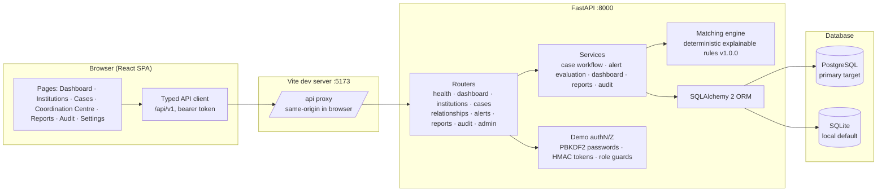
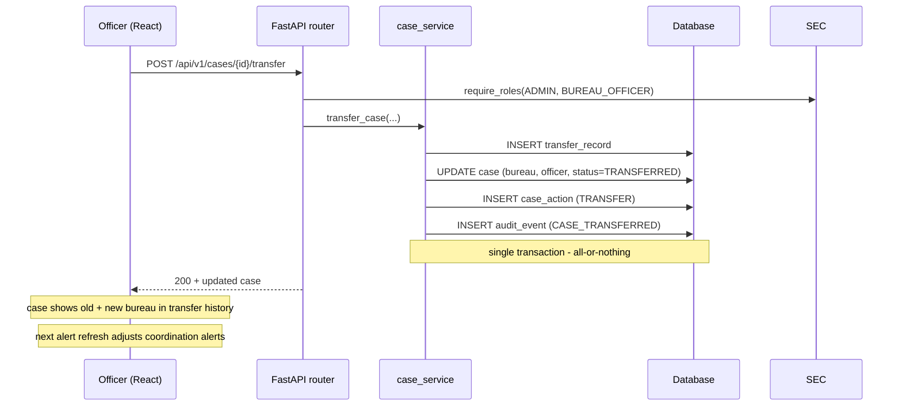

# INSTITRACE Architecture

## Overview

## Key design decisions

1. **Layered backend**: `routers` (HTTP contract + validation) → `services` (business logic,
   transactions) → `models` (SQLAlchemy) → database. The matching engine is a pure, separately
   importable module (`app/matching/`), never scattered across endpoints.

2. **Three domain concepts kept distinct**:
   - Institution linkage is just a foreign key.
   - Cross-bureau coordination is a `coordination_alerts` row evaluated from current workload.
   - Same-incident suspicion is a `relationship_assessments` row with explicit evidence lists
     and a human-review workflow.

3. **Two history layers**: `case_actions` is the per-case business history; `audit_events` is the
   system-wide, append-only audit trail (no update/delete routes exist).

4. **Idempotent alerting**: every operational alert has a deterministic `dedupe_key`. Re-running
   evaluation cannot duplicate an alert, auto-resolves alerts whose condition stopped holding,
   and never reopens human-resolved ones.

5. **Injectable clock**: all deadline logic reads `app.clock.now()`, so tests pin time and the
   behaviour is deterministic.

6. **Demo auth**: seeded users with per-user salted PBKDF2 hashes; signed expiring bearer tokens
   validated on the backend per endpoint (`require_roles`). Clearly labelled as demo-grade.

7. **Portable persistence**: SQLAlchemy core constructs only. SQLite is the tested default;
   PostgreSQL is the primary target through `INSTITRACE_DATABASE_URL` and Alembic migrations.

## Request flow example — transfer a case

## Module map

| Path | Responsibility |
| --- | --- |
| `backend/app/routers/*.py` | HTTP endpoints, request validation wiring, role guards |
| `backend/app/services/case_service.py` | Transactional case workflow, history + audit writes |
| `backend/app/services/alert_service.py` | Operational/cross-bureau alert evaluation with dedupe |
| `backend/app/services/matching_service.py` | Engine runner, review persistence, recompute |
| `backend/app/services/dashboard_service.py` | Metric definitions + queries |
| `backend/app/services/report_service.py` | Reports + CSV (injection-safe) |
| `backend/app/matching/engine.py` | Explainable deterministic rules R1–R6 |
| `backend/app/seed.py` | Deterministic synthetic data + fixture scenarios A–G |
| `frontend/src/pages/*` | One page per app module |
| `frontend/src/api/client.ts` | Typed API client, error normalization, session storage |
