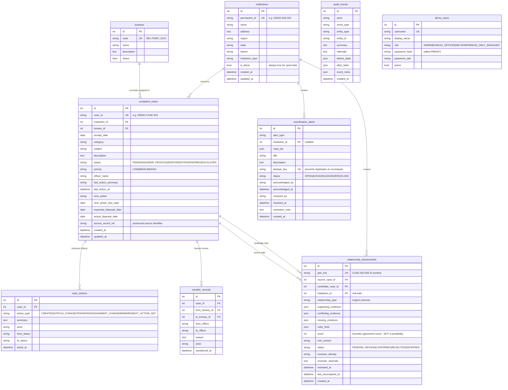
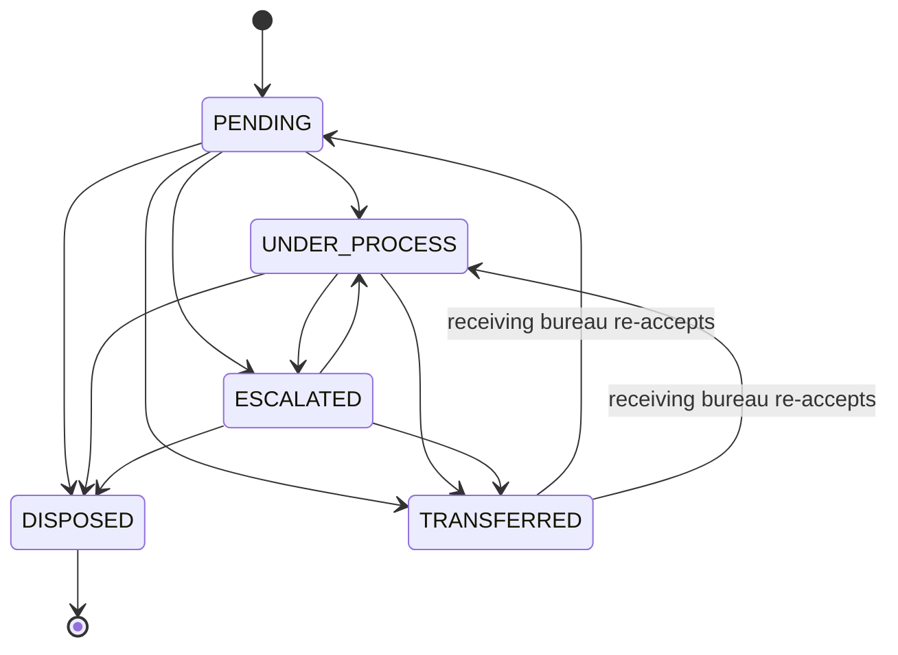

# INSTITRACE Database Schema

Managed by Alembic migrations (`backend/alembic/versions/`). Initial schema migration:
`69e0eedb34ac_initial_schema.py`. Apply with `alembic upgrade head` from `backend/`
(or simply run `python -m app.seed`, which migrates first).

Portable types and constraints only — no PostgreSQL-only behavior in business logic. Foreign
keys are enforced on SQLite via `PRAGMA foreign_keys=ON` (PostgreSQL enforces them natively).

## ER diagram

## Constraints and indexes

- **Uniqueness**: `institutions.permanent_id`, `complaint_cases.case_id`,
  `demo_users.username`, `relationship_assessments.pair_key`, `coordination_alerts.dedupe_key`.
- **Foreign keys**: cases → institutions/bureaus; histories → cases; assessments → both cases
  and institution; alerts → institution. Case history and transfers cascade with their case.
- **Indexes**: `permanent_id`, `case_id`, `institution_id`, `bureau_id`, `status`,
  `expected_disposal_date`, alert `(type, status)`, assessment `(status, relationship_type)`,
  audit `(entity_type, entity_id)`, audit `created_at`.
- **Audit append-only**: `audit_events` has no update/delete API routes; the interface is
  read-only by construction.

## Relationship assessment evidence model

Structured JSON is used **only** for evidence metadata (rule identifier, version, human-readable
detail, weight). The relational structure (cases, institution, statuses, review fields) lives in
proper typed columns — the evidence payload is the explainable payload of the rule engine, not a
data model hiding place.

## Status machine

`DISPOSED` is terminal. A transfer **never** disposes a case or erases history; the transfer is
recorded in `transfer_records` and `case_actions`, and the case waits for re-acceptance.
